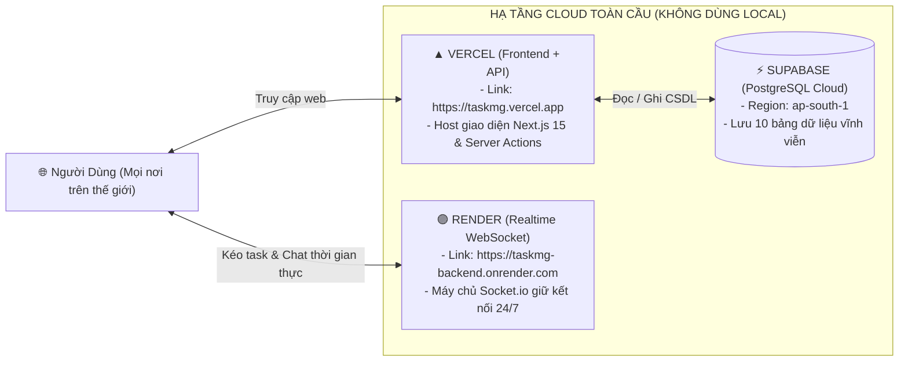

# 🚀 HỆ THỐNG QUẢN LÝ CÔNG VIỆC & DỰ ÁN (TASK MANAGEMENT SYSTEM - JIRA CLONE)

> **Mô hình triển khai:** **100% LIVE TRÊN CLOUD (Không cần chạy Local)**  
> **Kho lưu trữ:** [https://github.com/HuyDdoox/taskmg.git](https://github.com/HuyDdoox/taskmg.git)  
> **Chủ nhiệm dự án (PO / PM):** Sếp Huy Đỗ  
> **Đơn vị thực hiện:** Đội ngũ Kỹ thuật Thu nhỏ (Software House)

---

## 🌐 HỆ THỐNG ĐANG CHẠY LIVE TRỰC TUYẾN 24/7

---

## 📌 CÁC TÍNH NĂNG ĐÃ HOÀN THIỆN 100%

### 1. Bảng Kanban Kéo Thả Chuẩn Jira
- **4 Cột trạng thái chuẩn:** `Cần làm (To Do)` ➔ `Đang làm (In Progress)` ➔ `Xét duyệt (In Review)` ➔ `Hoàn thành (Done)`.
- **Thao tác kéo thả mượt mà:** Kéo thả thẻ công việc giữa các cột, tự động lưu vị trí (`order_index`) và đồng bộ thời gian thực qua WebSocket.
- **Bộ lọc nhanh 1-Click:**
  - 👤 *Chỉ việc của tôi*
  - 🔥 *Rủi ro cao (Critical / High)*
  - ⏰ *Sắp trễ hạn (Có deadline)*
  - 🎯 *Lọc theo từng Giai đoạn (Milestones)*

### 2. Quản Lý Task Chuẩn Doanh Nghiệp (Jira Task Anatomy)
- **Mã định danh tự động:** `#TASK-1`, `#TASK-2`... dễ sort tăng/giảm.
- **Phân loại Issue:** 🟢 Task | 🔵 Story | 🔴 Bug.
- **Đánh giá kép:** Độ ưu tiên (`Priority`) & Mức độ rủi ro (`Risk Level`).
- **Drawer trượt phải:** Bấm vào task sẽ mở bảng trượt bên phải hiển thị:
  - **Mô tả công việc (Overview & Goal)**.
  - **Chi tiết việc phải làm (Action Checklist):** Checkbox từng bước cụ thể, tự tính thanh tiến độ `0% ➔ 100%`.
  - **Nhật ký hoạt động (Audit Trail):** Ghi nhận vết ai đổi trạng thái lúc mấy giờ.

### 3. Kênh Chat Dự Án Thời Gian Thực (Realtime Chat)
- Tích hợp trực tiếp trên Sidebar, kết nối với máy chủ WebSocket Render.
- Chat thảo luận chung cho toàn bộ thành viên dự án, tin nhắn lưu vĩnh viễn vào Supabase.
- Hiển thị avatar, tên người gửi, thời gian gửi và bong bóng chat phân biệt Tôi / Đồng nghiệp.

### 4. Quản Lý Giai Đoạn (Project Milestones)
- Phân chia lộ trình dự án thành các giai đoạn: *GĐ 1: Khung xương MVP ➔ GĐ 2: Kanban Realtime ➔ GĐ 3: Chat Trao Đổi*.
- Thống kê % hoàn thành của từng giai đoạn dựa trên số task đã xong.

---

## 📂 GIẢI THÍCH CẤU TRÚC THƯ MỤC DỰ ÁN

| Thư mục / Tệp tin | Giải thích chi tiết (Dễ hiểu) |
| :--- | :--- |
| **`src/app/`** | Toàn bộ các trang và Server Actions của Next.js 15 App Router. |
| **`src/app/actions/`** | Chứa logic Backend xử lý CSDL: `task-actions.ts` (CRUD task), `chat-actions.ts` (Gửi tin nhắn). |
| **`src/components/kanban/`** | Giao diện Bảng Kanban, Drawer trượt chi tiết Task và Modal tạo task mới. |
| **`src/components/chat/`** | Giao diện phòng Chat thời gian thực. |
| **`src/components/layout/`** | Sidebar điều hướng xanh Jira và thanh Topbar. |
| **`src/components/milestones/`** | Màn hình hiển thị danh sách các Giai đoạn dự án. |
| **`src/hooks/useSocket.ts`** | Hook kết nối máy chủ WebSocket Render để tự động cập nhật khi người khác kéo task. |
| **`src/lib/prisma.ts`** | Khởi tạo kết nối an toàn tới CSDL Supabase PostgreSQL. |
| **`src/types/index.ts`** | Định nghĩa toàn bộ kiểu dữ liệu (Task, User, Column, Message...). |
| **`prisma/schema.prisma`** | Lược đồ thiết kế 10 bảng dữ liệu quan hệ. |
| **`prisma/seed.mjs`** | Mã nạp dữ liệu ban đầu (3 Users, Dự án TASK, 3 Milestones, 4 Cột, 7 Tasks). |
| **`server/`** | Mã nguồn máy chủ WebSocket Socket.io chạy độc lập trên Render. |
| **`docs/`** | Toàn bộ hồ sơ BA, Đặc tả nghiệp vụ, Lộ trình và Nhật ký luồng làm việc. |

---

## 🛠️ CÔNG NGHỆ SỬ DỤNG (TECH STACK)
- **Frontend & Fullstack:** Next.js 15 (React 19, Turbopack, App Router)
- **Styling & UI Kit:** Tailwind CSS v4, Lucide React Icons
- **Database ORM:** Prisma ORM 6.4.1
- **Database Cloud:** Supabase PostgreSQL Cloud (Region: `ap-south-1`)
- **Realtime Server:** Node.js, Express.js, Socket.io
- **Cloud Hosting:** Vercel (Web App) & Render (WebSocket Service)
