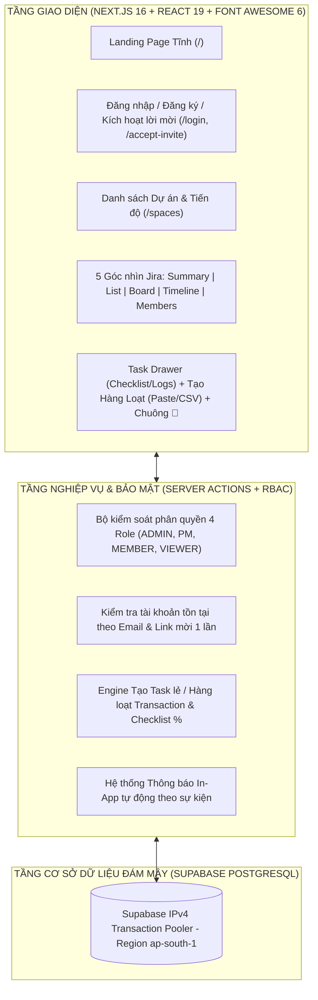

# BẢN KẾ HOẠCH TỔNG THỂ DỰ ÁN (MASTER PROJECT BLUEPRINT)

> **Dự án:** TaskMG Workspace — Hệ thống Quản lý Dự án & Công việc chuẩn Jira  
> **Chủ nhiệm dự án (PO / PM):** Anh (Sếp)  
> **Trạng thái:** **ĐÃ HOÀN THIỆN 100% & VẬN HÀNH LIVE TRÊN VERCEL + SUPABASE**  
> **URL Production:** [https://taskmg-six.vercel.app/](https://taskmg-six.vercel.app/)

---

## 1. KIẾN TRÚC TỔNG THỂ HỆ THỐNG (SYSTEM ARCHITECTURE)

---

## 2. PHẠM VI CÁC PHÂN HỆ ĐÃ TRIỂN KHAI HOÀN CHỈNH

| STT | Phân hệ Module | Chi tiết Nghiệp vụ Đã Hoàn Thiện |
| :---: | :--- | :--- |
| **1** | **Xác thực & Bảo mật Phiên** | • Đăng ký & Đăng nhập trực tiếp (`HttpOnly` HMAC-SHA256 Cookie). • Whitelist 4 tài khoản Demo `@company.com` (bảo vệ tài khoản thật). • Link mời thành viên mới `/accept-invite?token=...` tự đặt mật khẩu (chỉ dùng 1 lần). |
| **2** | **Đa Dự Án & Kiểm tra Nhân sự** | • Tạo dự án mới với mã `Project Key` tự động gợi ý, sinh sẵn 4 cột Kanban & Sprint 1. • Tính chính xác `% Tiến độ hoàn thành` trên thẻ dự án và Avatar viết tắt 2 chữ cái. • **Kiểm tra tài khoản đã tạo theo Email** trước khi thêm vào dự án (`Đã có tài khoản` / `Đã trong dự án` / `Chưa tạo tài khoản`). |
| **3** | **Quản lý Task & Tạo Hàng Loạt** | • Mã task tự động `#KEY-1, #KEY-2...`, phân loại `TASK/STORY/BUG/SUBTASK`, đánh giá kép `Priority` & `Risk Level`. • Tạo hàng loạt tới 100 task qua **Dán danh sách** (tự bóc tách `[BUG]/[STORY]` & `\| [HIGH]`) hoặc **Import file `.CSV`**. • Drawer chi tiết cho phép sửa trực tiếp Tiêu đề, Mô tả, Giai đoạn, thêm/tích/xóa `Action Checklist` (`0% ➔ 100%`) và xem `ActivityLog`. |
| **4** | **5 Góc nhìn Jira & Chuông 🔔** | • `Summary` (KPI & Charts), `List` (Sort 7 cột, Filter, Group by, Search, Inline Create), `Board` (Kéo thả Kanban 4 cột), `Timeline` (Milestones), `Members`. • Chuông thông báo In-App 🔔 thời gian thực khi giao việc, mời dự án, chờ duyệt `In Review`. • Chuyển đổi giao diện **Dark / Light Mode** & Responsive Mobile/Desktop. |
