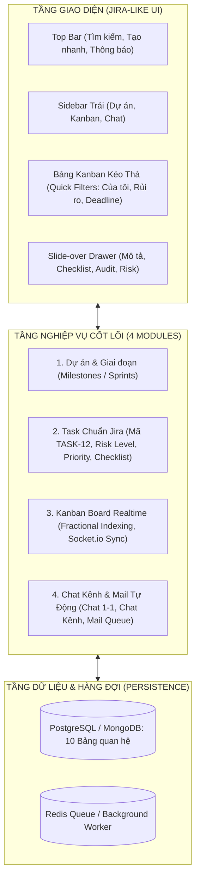
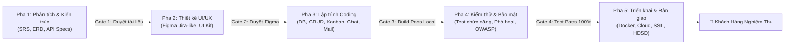

# BẢN KẾ HOẠCH TỔNG THỂ DỰ ÁN (MASTER PROJECT BLUEPRINT)
> **Dự án:** Website Quản lý Công việc & Dự án (Task Management - Chuẩn Jira thu nhỏ)  
> **Chủ nhiệm dự án (PO / PM):** Anh (Sếp)  
> **Đơn vị thực hiện:** Đội ngũ Kỹ thuật Thu nhỏ (Software House)  
> **Trạng thái:** Chờ phê duyệt chính thức (Pending Final Approval)

---

## 1. SƠ ĐỒ BỨC TRANH TỔNG THỂ HỆ THỐNG (SYSTEM OVERVIEW)

---

## 2. PHẠM VI 4 MODULE TÍNH NĂNG CHỐT

| STT | Phân hệ Module | Chi tiết Nghiệp vụ Chốt |
| :---: | :--- | :--- |
| **1** | **Quản lý Dự án & Giai đoạn** | • Tạo dự án với mã định danh (Project Key, vd: `TASK`). • Phân quyền thành viên (Admin, PM, Member, Viewer). • Chia công việc theo **Giai đoạn (Milestones / Sprints)** giúp dự án lớn không bị ngợp việc. |
| **2** | **Quản lý Task Chuẩn Jira** | • Mã task tự động: `#TASK-1`, `#TASK-2`... dễ sort tăng/giảm. • Phân loại: Task, Bug, Story. • Đánh giá kép: **Độ ưu tiên (Priority)** & **Mức độ rủi ro (Risk Level)**. • Khi ấn vào Task trượt ra Drawer: Gồm **Mô tả công việc (Overview)** và **Chi tiết việc phải làm (Action Checklist có % tiến độ)**. • Lưu vết thời gian `created_at`, `updated_at` và vị trí `order_index`. |
| **3** | **Bảng Kanban Kéo Thả** | • Kéo thả mượt mà, phân cột trạng thái tùy biến. • Bộ lọc nhanh (Quick Filters): *Việc của tôi, Rủi ro cao, Sắp hết hạn*. • Đồng bộ tức thì (Realtime Socket.io) khi thành viên khác kéo task. |
| **4** | **Chat Kênh & Mail Tự Động** | • Chat trực tiếp 1-1 giữa đồng nghiệp. • Chat theo Kênh Dự án và Bình luận thảo luận trong từng Task. • Gửi email tự động qua Background Queue (không làm đơ web) khi giao task, dời hạn, cảnh báo trễ hạn. *(Đã loại bỏ Video Meeting)*. |

---

## 3. LƯỢC ĐỒ CƠ SỞ DỮ LIỆU TINH GỌN (10 BẢNG CHUẨN HÓA)

1. `USERS`: Người dùng (id, email, full_name, password_hash, avatar_url).
2. `PROJECTS`: Dự án (id, name, project_key, description, owner_id).
3. `PROJECT_MEMBERS`: Phân quyền (project_id, user_id, role).
4. `MILESTONES`: Giai đoạn dự án (id, project_id, title, start_date, end_date, status).
5. `KANBAN_COLUMNS`: Cột Kanban (id, project_id, title, position).
6. `TASKS`: Thẻ công việc (id, task_number, issue_key, title, description, issue_type, priority, risk_level, column_id, milestone_id, assignee_id, reporter_id, order_index, due_date, created_at, updated_at).
7. `TASK_CHECKLISTS`: Chi tiết việc phải làm (id, task_id, title, is_completed, position).
8. `CHAT_CHANNELS`: Kênh chat dự án (id, project_id, name, type).
9. `MESSAGES`: Tin nhắn chat (id, channel_id, sender_id, content, created_at).
10. `ACTIVITY_LOGS`: Lịch sử vết thay đổi task (id, task_id, user_id, action, created_at).

---

## 4. LỘ TRÌNH 5 PHA THỰC THI & CỔNG NGHIỆM THU (QUALITY GATES)

- **Pha 1:** Xuất bản tài liệu đặc tả nghiệp vụ SRS + Lược đồ SQL Schema.
- **Pha 2:** Thiết kế bản mẫu Figma giao diện chuẩn Jira (Sidebar, Kanban, Slide Drawer).
- **Pha 3:** Lập trình Fullstack hoàn thiện 4 module.
- **Pha 4:** Kiểm thử gắt gao, rà soát lỗi bảo mật (IDOR, XSS, Race condition kéo thả).
- **Pha 5:** Đưa website lên Internet (HTTPS) và bàn giao cho khách hàng nghiệm thu.
