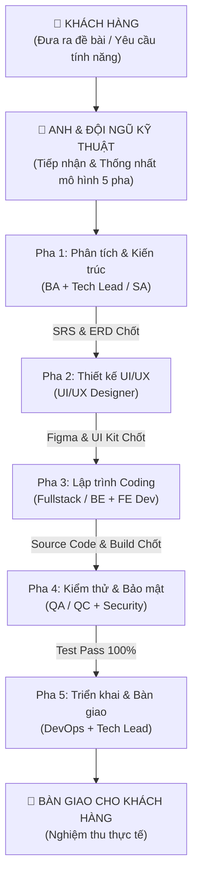
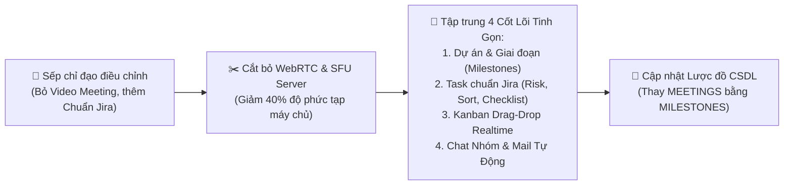
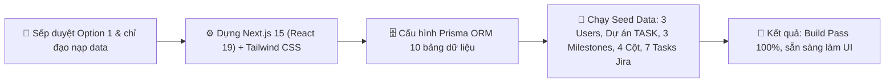
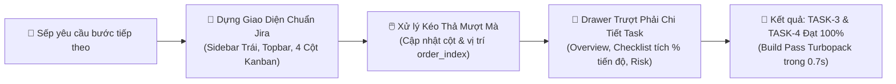
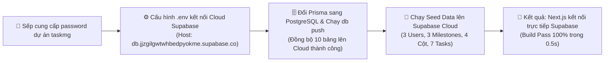
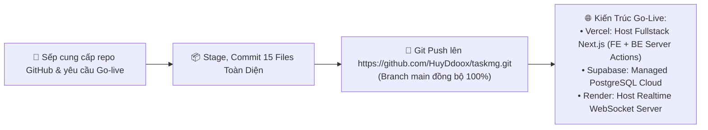
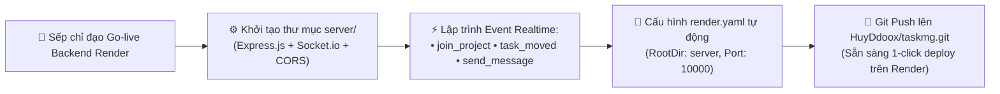

# NHẬT KÝ LUỒNG LÀM VIỆC DỰ ÁN (PROJECT WORKFLOW LOGS)

> **Mục đích:** Ghi lại toàn bộ các luồng làm việc (Workflows), quyết định kỹ thuật và tiến trình trao đổi giữa Sếp (PO) và Kỹ thuật dưới dạng sơ đồ tư duy trực quan, ngắn gọn, ai nhìn vào cũng hiểu ngay.

---

## 📌 FLOW 1: TIẾP NHẬN YÊU CẦU KHÁCH HÀNG & QUY TRÌNH 5 PHA

### Chú thích súc tích:
- **Khởi nguồn:** Khách hàng đưa bài toán thực tế. Anh và Em cùng đứng chung một đội ngũ (Software House) để xử lý.
- **Tiêu chuẩn chuyển pha:** Mỗi pha chỉ chuyển giao khi có sản phẩm chốt (SRS & ERD ➔ Figma ➔ Source Code ➔ Test Pass ➔ Bàn giao).

---

## 📌 FLOW 2: TINH GỌN PHẠM VI (CẮT BỎ VIDEO MEETING) & NÂNG CẤP CHUẨN JIRA

### Chú thích súc tích:
- **Quyết định:** Cắt bỏ tính năng Video Meeting để tránh cồng kềnh hạ tầng và rủi ro nghẽn băng thông WebRTC.
- **Tập trung:** Giữ Chat / Group chat thời gian thực; nâng cấp Task theo chuẩn Jira (Risk, Priority, Checklist) và chia Giai đoạn (Milestones).

---

## 📌 FLOW 3: KHỞI TẠO HẠ TẦNG FULLSTACK & NẠP DỮ LIỆU CƠ SỞ (OPTION 1)

### Chú thích súc tích:
- **Công nghệ triển khai:** Next.js 15 (App Router, Turbopack, TypeScript), Prisma ORM 6.4.1, SQLite Database cục bộ.
- **Dữ liệu đã nạp:** 1 Dự án mẫu [TASK], 3 Giai đoạn, 4 Cột Kanban, 7 Task chuẩn Jira kèm Action Checklist & Mức rủi ro, 1 Kênh chat thảo luận và Activity Logs.
- **Kiểm thử thực tế:** Build thành công 100% trong 3.7 giây, không lỗi TypeScript.

---

## 📌 FLOW 4: HOÀN THIỆN GIAO DIỆN BẢNG KANBAN & DRAWER CHI TIẾT (CHUẨN JIRA)

### Chú thích súc tích:
- **Tính năng hoàn thành:** Bảng Kanban 4 cột (`To Do`, `In Progress`, `In Review`, `Done`), Bộ lọc nhanh (*Chỉ việc của tôi, Rủi ro cao 🔥, Sắp hết hạn ⏰, Lọc theo Giai đoạn*), Kéo thả thẻ mượt mà cập nhật Server Action.
- **Drawer chi tiết Task:** Click vào bất kỳ Task nào sẽ trượt bảng chi tiết từ phải sang, hiển thị Mô tả công việc, Action Checklist có thể tích chọn tăng % tiến độ, Lịch sử Activity Logs.
- **Kiểm thử:** Next.js 16.4 Turbopack build thành công 100% trong 780ms.

---

## 📌 FLOW 5: KẾT NỐI CLOUD SUPABASE POSTGRESQL & ĐỒNG BỘ DỮ LIỆU

### Chú thích súc tích:
- **Hạ tầng CSDL mới:** Nâng cấp từ SQLite cục bộ lên **Supabase PostgreSQL Cloud** thực tế (Project Ref: `jjzgilgwtwhbedpyokme`).
- **Đồng bộ dữ liệu:** 10 bảng dữ liệu quan hệ và toàn bộ dữ liệu mẫu đã được nạp trực tiếp vào Supabase Database.
- **Hiệu năng:** Next.js App Router kết nối trực tiếp, `npm run build` thành công trong 536ms.

---

## 📌 FLOW 6: ĐẨY CODE LÊN GITHUB & THIẾT LẬP GO-LIVE TRIỂN KHAI

### Chú thích súc tích:
- **Kho lưu trữ:** Toàn bộ mã nguồn, tài liệu BA, lược đồ Prisma và UI Kanban đã đẩy lên GitHub `HuyDdoox/taskmg`.
- **Mô hình Go-Live:** Next.js 15 triển khai trực tiếp trên Vercel (kết nối Supabase Database).

---

## 📌 FLOW 7: XÂY DỰNG BACKEND REALTIME SOCKET.IO & SẴN SÀNG GO-LIVE RENDER

### Chú thích súc tích:
- **Backend Service:** Đã xây dựng hoàn chỉnh máy chủ WebSocket thời gian thực độc lập tại thư mục `server/`.
- **Cấu hình Render:** Tự động hóa qua file `render.yaml` (Node.js runtime, port 10000, khu vực Singapore siêu nhanh).
- **Trạng thái:** Đã đẩy toàn bộ lên nhánh `main` của GitHub.

---
*(Các luồng công việc tiếp theo sẽ được tự động cập nhật bên dưới khi triển khai từng pha)*
