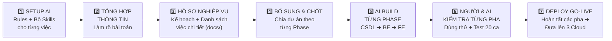

# CẨM NANG SLIDE THUYẾT TRÌNH: QUY TRÌNH 7 BƯỚC LÀM DỰ ÁN THỰC TẾ CÙNG AI
*(Từ Setup AI ➔ Tổng hợp Hồ sơ Nghiệp vụ & Việc làm chi tiết ➔ Chốt & Build từng Pha ➔ Người & AI Kiểm tra ➔ Deploy Go-Live)*

> **Sản phẩm Thực tế (Case Study):** TaskMG Workspace — Hệ thống Quản lý Dự án & Công việc chuẩn Jira  
> **Link Go-Live Vercel:** [https://taskmg-six.vercel.app/](https://taskmg-six.vercel.app/)  
> **Link Realtime Render v2.0:** [https://taskmg-backend.onrender.com/](https://taskmg-backend.onrender.com/)  
> **Kho Mã nguồn & Hồ sơ `docs/`:** [https://github.com/HuyDdoox/taskmg.git](https://github.com/HuyDdoox/taskmg.git)

---

## 🗺️ SƠ ĐỒ TƯ DUY TỔNG THỂ 7 BƯỚC (MASTER WORKFLOW)

---

## 📑 NỘI DUNG CHI TIẾT 9 SLIDES (KEYWORD NGẮN GỌN & LỜI THUYẾT TRÌNH)

### SLIDE 1: TRANG BÌA — QUY TRÌNH LÀM DỰ ÁN THỰC TẾ CÙNG AI
- **Keyword hiển thị trên Slide:**
  - 🧭 **Lộ trình:** `Setup AI` ➔ `Hồ sơ Nghiệp vụ` ➔ `Build từng Pha` ➔ `Deploy Go-Live`
  - 🤝 **Phối hợp:** Con người định hướng & duyệt — AI thực thi & kiểm thử
  - 🌐 **Sản phẩm Live:** `https://taskmg-six.vercel.app/`
  - 💻 **Mã nguồn:** `github.com/HuyDdoox/taskmg`
- **Lời thuyết trình (15 giây):**
  > *"Xin chào mọi người. Bài trình bày này chia sẻ quy trình 7 bước thực tế mà tôi đã áp dụng để điều phối AI đi từ khâu thiết lập ban đầu, lập hồ sơ nghiệp vụ, chia pha phát triển cho đến khi kiểm thử và đưa sản phẩm chạy Go-Live trên Cloud."*

---

### SLIDE 2: BƯỚC 1 — SETUP AI CHO CÁC CÔNG VIỆC KHÁC NHAU
- **Keyword hiển thị trên Slide:**
  - ⚙️ **`1. Cài đặt Rules cố định:`** Quy chuẩn làm việc 5 bước (*Plan & Confirm*)
  - 🏗️ **`2. Skill Quy trình 7 Pha:`** Dẫn dắt dự án bài bản từ đầu đến cuối
  - 🛡️ **`3. Skill Code Review & Debug:`** Soi chất lượng, bảo mật và tự sửa lỗi
  - 🧪 **`4. Skill Testing & Browser:`** Viết test và tự mở trình duyệt kiểm tra
- **Lời thuyết trình (20 giây):**
  > *"Bước đầu tiên và quan trọng nhất là không dùng AI một cách tự phát. Trước khi làm, tôi thiết lập sẵn cho AI bộ Rules cố định và các Skills chuyên biệt cho từng việc khác nhau: có skill chuyên dẫn dắt dự án theo từng pha, skill chuyên review bảo mật, skill chuyên sửa lỗi và skill tự mở trình duyệt kiểm thử."*

---

### SLIDE 3: BƯỚC 2 & 3 — TỔNG HỢP THÔNG TIN & LẬP HỒ SƠ NGHIỆP VỤ (`docs/`)
- **Keyword hiển thị trên Slide:**
  - 📥 **`1. Tổng hợp thông tin:`** Làm rõ bài toán, mục tiêu và đối tượng dùng
  - 📘 **`2. Kiến thức nghiệp vụ:`** Đặc tả quy tắc & phân quyền (`business_logic.md`)
  - 🗺️ **`3. Kế hoạch triển khai:`** Thiết kế kiến trúc & lược đồ 10 bảng CSDL
  - 📋 **`4. Danh sách việc chi tiết:`** Chia nhỏ từng đầu việc rõ ràng (`TASK-1` ➔ `TASK-15`)
- **Lời thuyết trình (25 giây):**
  > *"Bước thứ hai và thứ ba là thu thập, tổng hợp toàn bộ thông tin lại. Tuyệt đối chưa cho AI viết code ngay, mà phải tổng hợp thành bộ hồ sơ kiến thức nghiệp vụ, kế hoạch triển khai tổng thể và danh sách công việc chi tiết cho từng hạng mục lưu trong thư mục docs/."*

---

### SLIDE 4: BƯỚC 4 — BỔ SUNG, TINH GỌN & CHỐT DỰ ÁN THEO TỪNG PHA
- **Keyword hiển thị trên Slide:**
  - ✂️ **`1. Rà soát & Tinh gọn:`** Cắt bỏ Video/Chat thừa để tối ưu tốc độ web
  - ➕ **`2. Bổ sung sát thực tế:`** Chốt 5 góc nhìn Jira & phân quyền 4 Role RBAC
  - 🧱 **`3. Chia dự án theo từng Phase:`** Từ CSDL ➔ Backend ➔ Giao diện ➔ Kiểm thử
  - 🔒 **`4. Khóa cổng duyệt (Quality Gate):`** Chốt kế hoạch từng pha mới bắt đầu code
- **Lời thuyết trình (20 giây):**
  > *"Có hồ sơ nháp rồi, tôi tiến hành rà soát: cái gì rườm rà như Video họp là cắt bỏ, cái gì cần thiết là bổ sung thêm vào, sau đó mới chính thức chốt kế hoạch chia dự án ra làm từng Phase rõ ràng."*

---

### SLIDE 5: BƯỚC 5 — AI THỰC THI BUILD THEO TỪNG PHASE
- **Keyword hiển thị trên Slide:**
  - 🗄️ **`Phase 1 (Database):`** Khởi tạo 10 bảng PostgreSQL & nạp dữ liệu mẫu
  - 🔐 **`Phase 2 (Backend & Auth):`** Lập trình Server Actions, Cookie `HttpOnly` & RBAC
  - 💻 **`Phase 3 (Frontend 5 Views):`** Dựng `Summary`, `List`, `Board Kanban`, `Timeline`, `Members`
  - ⚡ **`Phase 4 (Realtime & Bell):`** Kết nối Socket.io Non-Blocking & Chuông thông báo 🔔
- **Lời thuyết trình (20 giây):**
  > *"Sang bước 5, AI bắt đầu build lần lượt từng Phase theo đúng tài liệu nghiệp vụ đã chốt: làm móng CSDL trước, tiếp theo là tầng Backend phân quyền, rồi mới dựng giao diện 5 góc nhìn chuẩn Jira và kết nối đồng bộ thời gian thực."*

---

### SLIDE 6: BƯỚC 6A — CON NGƯỜI KIỂM TRA TỪNG PHA & CHỈ ĐẠO NÂNG CẤP
- **Keyword hiển thị trên Slide:**
  - 👀 **`1. Trực tiếp dùng thử từng Phase`** để đánh giá trải nghiệm thực tế
  - 🎨 **`2. Giao diện & Biểu tượng:`** Yêu cầu đổi sang bộ Icon Font Awesome 6 sắc nét
  - ⚡ **`3. Tốc độ nhập việc:`** Bổ sung tính năng **Tạo Danh Sách Task Hàng Loạt** (*Paste / CSV*)
  - 🔍 **`4. Quản lý nhân sự:`** Bổ sung bước **Kiểm tra Email đã tạo tài khoản chưa**
- **Lời thuyết trình (20 giây):**
  > *"Ở bước 6, cứ xong mỗi Phase là tôi trực tiếp vào kiểm tra. Quá trình kiểm tra thực tế giúp tôi phát hiện và yêu cầu AI bổ sung ngay những tính năng rất sát sườn như đổi lại bộ Icon dự án, thêm tính năng Tạo danh sách Task hàng loạt và kiểm tra Email thành viên đã có tài khoản chưa trước khi thêm."*

---

### SLIDE 7: BƯỚC 6B — AI TỰ KIỂM TRA KỸ THUẬT & CHẠY TEST THỰC TẾ
- **Keyword hiển thị trên Slide:**
  - 🛠️ **`1. Tự kiểm tra Build:`** Chạy `npm run build` đảm bảo `0` lỗi TypeScript
  - 🤖 **`2. AI Browser tự chạy Test:`** Mở trình duyệt thao tác như người dùng thật
  - 🛒 **`3. Tạo dữ liệu thật:`** Tự đăng ký tài khoản, lập dự án **OmniShop** & **10 Tasks**
  - 🛡️ **`4. Vượt 20/20 kịch bản QA:`** Kiểm chứng phân quyền RBAC, chống IDOR & XSS
- **Lời thuyết trình (20 giây):**
  > *"Song song với sự kiểm tra của tôi, tôi yêu cầu AI tự kiểm tra kỹ thuật và tự mở trình duyệt chạy kiểm thử 20 kịch bản từ tạo tài khoản mới, lập dự án thương mại điện tử OmniShop với 10 đầu việc thật cho đến kiểm tra bảo mật phân quyền ngay trước mắt."*

---

### SLIDE 8: BƯỚC 7 — HOÀN THÀNH CÁC GIAI ĐOẠN & DEPLOY CHẠY GO-LIVE
- **Keyword hiển thị trên Slide:**
  - ✅ **`1. Hoàn tất nghiệm thu 100% các Phase`** theo đúng hồ sơ nghiệp vụ
  - 📦 **`2. Đóng gói mã nguồn & bộ tài liệu chuẩn`** đẩy lên GitHub chính thức
  - ☁️ **`3. Deploy Go-Live 3 Cloud:`** `Vercel` (Web) + `Render` (Realtime v2.0) + `Supabase` (DB)
  - 📄 **`4. Xuất hồ sơ bàn giao & báo cáo QA`** sẵn sàng vận hành 24/7
- **Lời thuyết trình (20 giây):**
  > *"Chỉ khi toàn bộ các giai đoạn đã hoàn thành và vượt qua mọi bài kiểm thử của cả người lẫn AI, dự án mới bước sang Bước 7: đóng gói đẩy lên GitHub và triển khai chạy Go-Live chính thức trên 3 nền tảng đám mây Vercel, Render và Supabase."*

---

### SLIDE 9: TỔNG KẾT — 4 TRỤ CỘT LÀM CHỦ AI ĐỂ TẠO SẢN PHẨM HOÀN CHỈNH
- **Keyword hiển thị trên Slide:**
  - 🥇 **`01. Setup AI đúng vai trò & kỹ năng ngay từ đầu`**
  - 🥈 **`02. Có Hồ sơ nghiệp vụ & Danh sách việc chi tiết mới code`**
  - 🥉 **`03. Chia theo từng Phase — Người & AI cùng kiểm tra gắt gao`**
  - 🏆 **`04. Hoàn thiện 100% các giai đoạn rồi Deploy chạy Go-Live thực tế`**
- **Lời thuyết trình (15 giây):**
  > *"Tổng kết lại, công thức để làm chủ AI tạo ra sản phẩm hoàn chỉnh nằm ở 4 trụ cột: Setup AI bài bản từ đầu, lập hồ sơ nghiệp vụ và danh sách việc chi tiết trước khi code, chia dự án theo từng Phase có người và AI cùng kiểm tra, và hoàn tất 100% mới đưa lên vận hành Go-Live. Xin cảm ơn!"*
