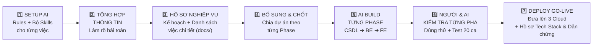

# CẨM NANG SLIDE THUYẾT TRÌNH (11 TRANG): QUY TRÌNH 7 BƯỚC LÀM DỰ ÁN THỰC TẾ CÙNG AI
*(Từ Setup AI ➔ Tổng hợp Hồ sơ Nghiệp vụ & Việc làm chi tiết ➔ Chốt & Build từng Pha ➔ Người & AI Kiểm tra ➔ Deploy Go-Live ➔ Bộ Công cụ Tham khảo & Dẫn chứng Thực tế)*

> **Link Canva Đang Chỉnh Sửa (`DAHcCbw3xOo`):** [https://www.canva.com/design/DAHcCbw3xOo/iisJijFylWA3Z6XIf9BZVQ/edit](https://www.canva.com/design/DAHcCbw3xOo/iisJijFylWA3Z6XIf9BZVQ/edit)  
> **Sản phẩm Thực tế (Case Study):** TaskMG Workspace — Hệ thống Quản lý Dự án & Công việc chuẩn Jira  
> **Link Go-Live Vercel:** [https://taskmg-six.vercel.app/](https://taskmg-six.vercel.app/)  
> **Link Realtime Render v2.0:** [https://taskmg-backend.onrender.com/](https://taskmg-backend.onrender.com/)  
> **Kho Mã nguồn & Hồ sơ `docs/`:** [https://github.com/HuyDdoox/taskmg.git](https://github.com/HuyDdoox/taskmg.git)

---

## 🗺️ SƠ ĐỒ TƯ DUY TỔNG THỂ 7 BƯỚC + HỒ SƠ THAM KHẢO (MASTER WORKFLOW)

---

## 📑 NỘI DUNG CHI TIẾT 11 SLIDES (KEYWORD NGẮN GỌN & LỜI THUYẾT TRÌNH)

### SLIDE 1: TRANG BÌA — QUY TRÌNH LÀM DỰ ÁN THỰC TẾ CÙNG AI
- **Keyword hiển thị trên Slide:**
  - 🧭 **Lộ trình:** `Setup AI` ➔ `Hồ sơ Nghiệp vụ` ➔ `Build từng Pha` ➔ `Deploy Go-Live`
  - 🤝 **Phối hợp:** Con người định hướng & duyệt — AI thực thi & kiểm thử
  - 📘 **Phương pháp:** `7 Bước Điều Phối AI Chuẩn`
  - 🚀 **Thực chiến:** `Dẫn Chứng Dự Án Thực Tế (Ở Cuối Bài)`

---

### SLIDE 2: BƯỚC 1 — SETUP AI CHO CÁC CÔNG VIỆC KHÁC NHAU *(Hướng dẫn tổng quát)*
- **Keyword hiển thị trên Slide:**
  - ⚙️ **`1. Cài đặt Rules cố định:`** Quy chuẩn làm việc 5 bước (*Plan & Confirm*)
  - 🏗️ **`2. Skill Quy trình 7 Pha:`** Dẫn dắt dự án bài bản từ đầu đến cuối
  - 🛡️ **`3. Skill Code Review & Debug:`** Soi chất lượng, bảo mật và tự sửa lỗi
  - 🧪 **`4. Skill Testing & Browser:`** Viết test và tự mở trình duyệt kiểm tra

---

### SLIDE 3: BƯỚC 2 & 3 — TỔNG HỢP THÔNG TIN & LẬP HỒ SƠ NGHIỆP VỤ (`docs/`) *(Hướng dẫn tổng quát)*
- **Keyword hiển thị trên Slide:**
  - 📥 **`1. Tổng hợp thông tin:`** Làm rõ bài toán, mục tiêu và đối tượng dùng
  - 📘 **`2. Kiến thức nghiệp vụ:`** Đặc tả quy tắc nghiệp vụ & ma trận phân quyền
  - 🗺️ **`3. Kế hoạch triển khai:`** Thiết kế kiến trúc & lược đồ cơ sở dữ liệu
  - 📋 **`4. Danh sách việc chi tiết:`** Chia nhỏ từng đầu việc theo mã thứ tự rõ ràng

---

### SLIDE 4: BƯỚC 4 — BỔ SUNG, TINH GỌN & CHỐT DỰ ÁN THEO TỪNG PHA *(Hướng dẫn tổng quát)*
- **Keyword hiển thị trên Slide:**
  - ✂️ **`1. Rà soát & Tinh gọn:`** Loại bỏ tính năng rườm rà để tối ưu tốc độ hệ thống
  - ➕ **`2. Bổ sung sát thực tế:`** Chốt các tính năng cốt lõi & phân quyền vai trò
  - 🧱 **`3. Chia dự án theo từng Phase:`** Từ CSDL ➔ Backend ➔ Giao diện ➔ Kiểm thử
  - 🔒 **`4. Khóa cổng duyệt (Quality Gate):`** Chốt kế hoạch từng pha mới bắt đầu code

---

### SLIDE 5: BƯỚC 5 — AI THỰC THI BUILD THEO TỪNG PHASE *(Hướng dẫn tổng quát)*
- **Keyword hiển thị trên Slide:**
  - 🗄️ **`Phase 1:`** Thiết kế cấu trúc CSDL & nạp dữ liệu nền tảng
  - 🔐 **`Phase 2:`** Lập trình API Backend, Xác thực bảo mật & Phân quyền
  - 💻 **`Phase 3:`** Xây dựng Giao diện người dùng (UI/UX) & Luồng tương tác
  - ⚡ **`Phase 4:`** Tích hợp đồng bộ thời gian thực & Tối ưu tốc độ

---

### SLIDE 6: BƯỚC 6A — CON NGƯỜI KIỂM TRA TỪNG PHA & CHỈ ĐẠO NÂNG CẤP *(Hướng dẫn tổng quát)*
- **Keyword hiển thị trên Slide:**
  - 👀 **`1. Trải nghiệm từng pha:`** Dùng thử để đánh giá trải nghiệm thực tế
  - 🎨 **`2. Giao diện & Trải nghiệm:`** Chỉ đạo AI tinh chỉnh bố cục, màu sắc & biểu tượng trực quan
  - ⚡ **`3. Tiện ích thao tác nhanh:`** Yêu cầu bổ sung công cụ nhập liệu & xử lý dữ liệu hàng loạt
  - 🔍 **`4. Chặt chẽ nghiệp vụ:`** Rà soát & bổ sung các bước kiểm tra tính hợp lệ dữ liệu đầu vào

---

### SLIDE 7: BƯỚC 6B — AI TỰ KIỂM TRA KỸ THUẬT & CHẠY TEST THỰC TẾ *(Hướng dẫn tổng quát)*
- **Keyword hiển thị trên Slide:**
  - 🛠️ **`1. Tự kiểm tra Build:`** Chạy lệnh Build kiểm tra `0` lỗi cú pháp & kiểu dữ liệu
  - 🤖 **`2. AI Browser tự chạy Test:`** AI mở trình duyệt tự động thao tác như người dùng thật
  - 🛒 **`3. Tạo dữ liệu thật:`** Tự đăng ký tài khoản, tạo dữ liệu mẫu & test luồng E2E
  - 🛡️ **`4. Vượt toàn bộ kịch bản QA:`** Kiểm chứng bảo mật phân quyền, chống truy cập trái phép

---

### SLIDE 8: BƯỚC 7 — HOÀN THÀNH CÁC GIAI ĐOẠN & DEPLOY CHẠY GO-LIVE *(Hướng dẫn tổng quát)*
- **Keyword hiển thị trên Slide:**
  - ✅ **`1. Hoàn tất nghiệm thu 100%`** các Phase theo đúng hồ sơ nghiệp vụ
  - 📦 **`2. Đóng gói mã nguồn &`** bộ tài liệu chuẩn đẩy lên GitHub chính thức
  - ☁️ **`3. Triển khai lên hạ tầng Cloud:`** Máy chủ Web App + Máy chủ Realtime + Cơ sở dữ liệu Đám mây
  - 📄 **`4. Xuất hồ sơ bàn giao &`** báo cáo QA sẵn sàng vận hành 24/7

---

### SLIDE 9 (MỚI): HỒ SƠ CÔNG NGHỆ, BỘ TOOL AI & HẠ TẦNG DEPLOY THAM KHẢO
*(Giúp người xem biết chính xác cần dùng Tool gì, lấy thông tin ở đâu và deploy thế nào để làm theo)*

- **Khối 1 — 🤖 Công Cụ AI & Môi Trường Máy Tính (AI & Environment):**
  - **Hệ điều hành & Terminal:** `Windows` + `PowerShell`
  - **Trợ lý AI IDE:** `Google Antigravity IDE` (Cài đặt `Global Rules` 5 bước + 4 `Skills` chuyên biệt)
  - **Tự động hóa (MCP):** `AI Browser Agent` (test E2E tự động), `Chrome DevTools MCP`, `Canva MCP`
- **Khối 2 — 📂 Nguồn Thông Tin & Hồ Sơ Đầu Vào (`docs/`):**
  - **Nguồn nghiệp vụ:** Đề bài từ Product Owner theo chuẩn quản lý công việc **Atlassian Jira**
  - **4 File Hồ sơ gốc trong Repo:** `business_logic.md` (SRS & RBAC), `ke_hoach_tong_the_du_an.md` (10 bảng CSDL), `project_flows.md` (Sơ đồ Mermaid), `qa_test_report.md` (20 Test Cases)
- **Khối 3 — 💻 Công Nghệ Lập Trình (Fullstack Tech Stack):**
  - **Frontend & UI:** `Next.js 16` (App Router, Turbopack), `React 19`, `TypeScript 5`, `Tailwind CSS 4`, `Font Awesome 6`
  - **Backend & Bảo mật:** `Next.js Server Actions`, Cookie `HttpOnly` (`HMAC-SHA256`), mật khẩu `scrypt`, `Prisma ORM 6.4`
  - **Realtime Engine:** `Node.js` + `Express` + `Socket.io 4.8` (Kết nối ngầm Non-Blocking)
- **Khối 4 — ☁️ Nơi Lưu Trữ & Công Cụ Deploy Go-Live (3-Cloud CI/CD):**
  - **Quản lý Code & CI/CD:** `Git` + `GitHub` (`github.com/HuyDdoox/taskmg` — tự động build khi `git push`)
  - **Deploy Web & API:** `Vercel Cloud` (Region `bom1` Mumbai)
  - **Deploy Realtime Server:** `Render Cloud` (Tự động qua `render.yaml`, Region Singapore)
  - **Deploy Database:** `Supabase PostgreSQL Cloud` (Region `ap-south-1`, cổng `IPv4 Pooler 6543`)

---

### SLIDE 10 (MỚI): ÁP DỤNG THỰC TẾ — VẬN HÀNH DỰ ÁN TASKMG WORKSPACE
*(Luồng phối hợp 4 Vai trò • 5 Góc nhìn Jira • Đang chạy thực tế tại `https://taskmg-six.vercel.app/`)*

- **Ô 01 — 👑 Khởi Tạo & Lập Kế Hoạch (`ADMIN / PM`):**
  - **`KHÔNG GIAN /SPACES`:** Quản lý đa dự án độc lập trên cùng một hệ thống.
  - **`CHECK EMAIL & MỜI`:** Kiểm tra email tài khoản tồn tại & phân quyền 4 Role RBAC.
  - **`CHIA GIAI ĐOẠN`:** Lập các kỳ Sprint & Milestone theo tiến độ dự án.
  - **`TẠO TASK HÀNG LOẠT`:** Dùng Smart Paste tự tách Tag (`[BUG] | [HIGH]`) & Import file `.CSV`.
- **Ô 02 — 👨‍💻 Nhận Việc & Thực Thi (`MEMBER & REALTIME`):**
  - **`CHUÔNG REALTIME`:** Báo giao việc mới & lời mời tham gia dự án tức thì qua WebSocket.
  - **`NHẬN TASK CÁ NHÂN`:** Lọc nhanh công việc của mình theo chữ viết tắt Avatar.
  - **`TASK DRAWER CHI TIẾT`:** Cập nhật mô tả, tích Action Checklist tiến độ `0% ➔ 100%`.
  - **`KÉO SANG IN REVIEW`:** Hệ thống tự động khóa cột `Done` đối với Member để chờ PM duyệt.
- **Ô 03 — 📊 5 Góc Nhìn Quản Trị & Duyệt Việc (`PM / VIEWER`):**
  - **`KANBAN & LIST VIEW`:** Kéo thả trạng thái 4 cột & lọc đa chiều theo Rủi ro/Ưu tiên.
  - **`SUMMARY & TIMELINE`:** Biểu đồ % hoàn thành dự án & lộ trình thanh thời gian Gantt.
  - **`PM DUYỆT SANG DONE`:** PM kiểm tra công việc ở cột `In Review` và chốt nghiệm thu sang `Done`.
  - **`CHẾ ĐỘ VIEWER (KHÁCH)`:** Giảng viên/Khách hàng vào giám sát trực tiếp ở chế độ `Read-Only`.
- **Ô 04 — 🚀 Hiệu Quả Áp Dụng Trên 2 Dự Án Live (`[TASK]` & `[OMNI]`):**
  - **`DỰ ÁN [TASK] (15 VIỆC)`:** 4 Giai đoạn Sprint • 4 Vai trò Phân quyền RBAC thực tế.
  - **`DỰ ÁN [OMNI] (10 VIỆC)`:** Dự án Thương mại điện tử OmniShop do AI tự lập từ số 0.
  - **`68 SỰ KIỆN REALTIME`:** Đồng bộ trực tiếp qua máy chủ Render WebSocket v2.0.
  - **`20/20 QA • BUILD 1.38S`:** Chặn truy cập trái phép IDOR & Chống XSS 100%.

---

### SLIDE 11: TỔNG KẾT — 4 TRỤ CỘT LÀM CHỦ AI ĐỂ TẠO SẢN PHẨM HOÀN CHỈNH
- **Keyword hiển thị trên Slide:**
  - 🥇 **`01. Setup AI đúng vai trò & kỹ năng ngay từ đầu`**
  - 🥈 **`02. Có Hồ sơ nghiệp vụ & Danh sách việc chi tiết mới code`**
  - 🥉 **`03. Chia theo từng Phase — Người & AI cùng kiểm tra gắt gao`**
  - 🏆 **`04. Hoàn thiện 100% các giai đoạn rồi Deploy chạy Go-Live thực tế`**
