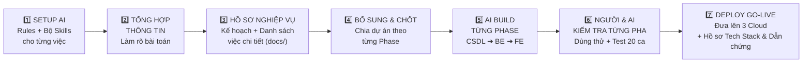

# CẨM NANG SLIDE THUYẾT TRÌNH (11 TRANG): QUY TRÌNH 7 BƯỚC LÀM DỰ ÁN THỰC TẾ CÙNG AI
*(Từ Setup AI ➔ Tổng hợp Hồ sơ Nghiệp vụ & Việc làm chi tiết ➔ Chốt & Build từng Pha ➔ Người & AI Kiểm tra ➔ Deploy Go-Live ➔ Bộ Công cụ Tham khảo & Dẫn chứng Thực tế)*

> **Link Canva Đang Chỉnh Sửa (`DAHcCbw3xOo`):** [https://www.canva.com/design/DAHcCbw3xOo/iisJijFylWA3Z6XIf9BZVQ/edit](https://www.canva.com/design/DAHcCbw3xOo/iisJijFylWA3Z6XIf9BZVQ/edit)  
> **Sản phẩm Thực tế (Case Study):** TaskMG Workspace — Hệ thống Quản lý Dự án & Công việc chuẩn Jira  
> **Link Go-Live Vercel:** [https://taskmg-six.vercel.app/](https://taskmg-six.vercel.app/)  
> **Link Realtime Render v2.0:** [https://taskmg-backend.onrender.com/](https://taskmg-backend.onrender.com/)  
> **Kho Mã nguồn & Hồ sơ `docs/`:** [https://github.com/HuyDdoox/taskmg.git](https://github.com/HuyDdoox/taskmg.git)

---

## 🗺️ SƠ ĐỒ TƯ DUY TỔNG THỂ 7 BƯỚC + HỒ SƠ THAM KHẢO (MASTER WORKFLOW)

---

## 📑 NỘI DUNG CHI TIẾT 11 SLIDES (KEYWORD NGẮN GỌN & LỜI THUYẾT TRÌNH)

### SLIDE 1: TRANG BÌA — QUY TRÌNH LÀM DỰ ÁN THỰC TẾ CÙNG AI
- **Keyword hiển thị trên Slide:**
  - 🧭 **Lộ trình:** `Setup AI` ➔ `Hồ sơ Nghiệp vụ` ➔ `Build từng Pha` ➔ `Deploy Go-Live`
  - 🤝 **Phối hợp:** Con người định hướng & duyệt — AI thực thi & kiểm thử
  - 🌐 **Sản phẩm Live:** `https://taskmg-six.vercel.app/`
  - 💻 **Mã nguồn:** `github.com/HuyDdoox/taskmg`

---

### SLIDE 2: BƯỚC 1 — SETUP AI CHO CÁC CÔNG VIỆC KHÁC NHAU
- **Keyword hiển thị trên Slide:**
  - ⚙️ **`1. Cài đặt Rules cố định:`** Quy chuẩn làm việc 5 bước (*Plan & Confirm*)
  - 🏗️ **`2. Skill Quy trình 7 Pha:`** Dẫn dắt dự án bài bản từ đầu đến cuối
  - 🛡️ **`3. Skill Code Review & Debug:`** Soi chất lượng, bảo mật và tự sửa lỗi
  - 🧪 **`4. Skill Testing & Browser:`** Viết test và tự mở trình duyệt kiểm tra

---

### SLIDE 3: BƯỚC 2 & 3 — TỔNG HỢP THÔNG TIN & LẬP HỒ SƠ NGHIỆP VỤ (`docs/`)
- **Keyword hiển thị trên Slide:**
  - 📥 **`1. Tổng hợp thông tin:`** Làm rõ bài toán, mục tiêu và đối tượng dùng
  - 📘 **`2. Kiến thức nghiệp vụ:`** Đặc tả quy tắc & phân quyền (`business_logic.md`)
  - 🗺️ **`3. Kế hoạch triển khai:`** Thiết kế kiến trúc & lược đồ 10 bảng CSDL
  - 📋 **`4. Danh sách việc chi tiết:`** Chia nhỏ từng đầu việc rõ ràng (`TASK-1` ➔ `TASK-15`)

---

### SLIDE 4: BƯỚC 4 — BỔ SUNG, TINH GỌN & CHỐT DỰ ÁN THEO TỪNG PHA
- **Keyword hiển thị trên Slide:**
  - ✂️ **`1. Rà soát & Tinh gọn:`** Cắt bỏ Video/Chat thừa để tối ưu tốc độ web
  - ➕ **`2. Bổ sung sát thực tế:`** Chốt 5 góc nhìn Jira & phân quyền 4 Role RBAC
  - 🧱 **`3. Chia dự án theo từng Phase:`** Từ CSDL ➔ Backend ➔ Giao diện ➔ Kiểm thử
  - 🔒 **`4. Khóa cổng duyệt (Quality Gate):`** Chốt kế hoạch từng pha mới bắt đầu code

---

### SLIDE 5: BƯỚC 5 — AI THỰC THI BUILD THEO TỪNG PHASE
- **Keyword hiển thị trên Slide:**
  - 🗄️ **`Phase 1 (Database):`** Khởi tạo 10 bảng PostgreSQL & nạp dữ liệu mẫu
  - 🔐 **`Phase 2 (Backend & Auth):`** Lập trình Server Actions, Cookie `HttpOnly` & RBAC
  - 💻 **`Phase 3 (Frontend 5 Views):`** Dựng `Summary`, `List`, `Board Kanban`, `Timeline`, `Members`
  - ⚡ **`Phase 4 (Realtime & Bell):`** Kết nối Socket.io Non-Blocking & Chuông thông báo 🔔

---

### SLIDE 6: BƯỚC 6A — CON NGƯỜI KIỂM TRA TỪNG PHA & CHỈ ĐẠO NÂNG CẤP
- **Keyword hiển thị trên Slide:**
  - 👀 **`1. Trực tiếp dùng thử từng Phase`** để đánh giá trải nghiệm thực tế
  - 🎨 **`2. Giao diện & Biểu tượng:`** Yêu cầu đổi sang bộ Icon Font Awesome 6 sắc nét
  - ⚡ **`3. Tốc độ nhập việc:`** Bổ sung tính năng **Tạo Danh Sách Task Hàng Loạt** (*Paste / CSV*)
  - 🔍 **`4. Quản lý nhân sự:`** Bổ sung bước **Kiểm tra Email đã tạo tài khoản chưa**

---

### SLIDE 7: BƯỚC 6B — AI TỰ KIỂM TRA KỸ THUẬT & CHẠY TEST THỰC TẾ
- **Keyword hiển thị trên Slide:**
  - 🛠️ **`1. Tự kiểm tra Build:`** Chạy `npm run build` đảm bảo `0` lỗi TypeScript
  - 🤖 **`2. AI Browser tự chạy Test:`** Mở trình duyệt thao tác như người dùng thật
  - 🛒 **`3. Tạo dữ liệu thật:`** Tự đăng ký tài khoản, lập dự án **OmniShop** & **10 Tasks**
  - 🛡️ **`4. Vượt 20/20 kịch bản QA:`** Kiểm chứng phân quyền RBAC, chống IDOR & XSS

---

### SLIDE 8: BƯỚC 7 — HOÀN THÀNH CÁC GIAI ĐOẠN & DEPLOY CHẠY GO-LIVE
- **Keyword hiển thị trên Slide:**
  - ✅ **`1. Hoàn tất nghiệm thu 100% các Phase`** theo đúng hồ sơ nghiệp vụ
  - 📦 **`2. Đóng gói mã nguồn & bộ tài liệu chuẩn`** đẩy lên GitHub chính thức
  - ☁️ **`3. Deploy Go-Live 3 Cloud:`** `Vercel` (Web) + `Render` (Realtime v2.0) + `Supabase` (DB)
  - 📄 **`4. Xuất hồ sơ bàn giao & báo cáo QA`** sẵn sàng vận hành 24/7

---

### SLIDE 9 (MỚI): HỒ SƠ CÔNG NGHỆ, BỘ TOOL AI & HẠ TẦNG DEPLOY THAM KHẢO
*(Giúp người xem biết chính xác cần dùng Tool gì, lấy thông tin ở đâu và deploy thế nào để làm theo)*

- **Khối 1 — 🤖 Công Cụ AI & Môi Trường Máy Tính (AI & Environment):**
  - **Hệ điều hành & Terminal:** `Windows` + `PowerShell`
  - **Trợ lý AI IDE:** `Google Antigravity IDE` (Cài đặt `Global Rules` 5 bước + 4 `Skills` chuyên biệt)
  - **Tự động hóa (MCP):** `AI Browser Agent` (test E2E tự động), `Chrome DevTools MCP`, `Canva MCP`
- **Khối 2 — 📂 Nguồn Thông Tin & Hồ Sơ Đầu Vào (`docs/`):**
  - **Nguồn nghiệp vụ:** Đề bài từ Product Owner theo chuẩn quản lý công việc **Atlassian Jira**
  - **4 File Hồ sơ gốc trong Repo:** `business_logic.md` (SRS & RBAC), `ke_hoach_tong_the_du_an.md` (10 bảng CSDL), `project_flows.md` (Sơ đồ Mermaid), `qa_test_report.md` (20 Test Cases)
- **Khối 3 — 💻 Công Nghệ Lập Trình (Fullstack Tech Stack):**
  - **Frontend & UI:** `Next.js 16` (App Router, Turbopack), `React 19`, `TypeScript 5`, `Tailwind CSS 4`, `Font Awesome 6`
  - **Backend & Bảo mật:** `Next.js Server Actions`, Cookie `HttpOnly` (`HMAC-SHA256`), mật khẩu `scrypt`, `Prisma ORM 6.4`
  - **Realtime Engine:** `Node.js` + `Express` + `Socket.io 4.8` (Kết nối ngầm Non-Blocking)
- **Khối 4 — ☁️ Nơi Lưu Trữ & Công Cụ Deploy Go-Live (3-Cloud CI/CD):**
  - **Quản lý Code & CI/CD:** `Git` + `GitHub` (`github.com/HuyDdoox/taskmg` — tự động build khi `git push`)
  - **Deploy Web & API:** `Vercel Cloud` (Region `bom1` Mumbai)
  - **Deploy Realtime Server:** `Render Cloud` (Tự động qua `render.yaml`, Region Singapore)
  - **Deploy Database:** `Supabase PostgreSQL Cloud` (Region `ap-south-1`, cổng `IPv4 Pooler 6543`)

---

### SLIDE 10 (MỚI): DẪN CHỨNG KẾT QUẢ THỰC TẾ TỪ DỰ ÁN TASKMG WORKSPACE
*(Các bằng chứng sống đang chạy trực tiếp tại `https://taskmg-six.vercel.app/`)*

- **Dẫn chứng 1 — 🗂️ Dự Án Mẫu `TASK` (15 Công Việc & 4 Vai Trò RBAC):**
  - 10 bảng PostgreSQL trên Supabase; 4 tài khoản mẫu `@company.com` kiểm chứng phân quyền (`ADMIN` toàn quyền, `PM` quản lý, `MEMBER` bị khóa cột `Done` 🔒, `VIEWER` chỉ xem, chặn đứng **IDOR** khi truy cập trái phép).
- **Dẫn chứng 2 — 🛒 Dự Án Thật `OmniShop E-Commerce` (`Key: OMNI`):**
  - Do **AI Browser Agent** tự mở trình duyệt đăng ký tài khoản mới (`minhquan.lead@company.com`), tự khởi tạo dự án thật với **5 thành viên**, **3 Giai đoạn (Sprints)** và **10 Công việc (`OMNI-1` ➔ `OMNI-10`)**.
- **Dẫn chứng 3 — ⚡ Các Tính Năng Thực Chiến Nâng Cấp Theo Lệnh PO:**
  - **Tạo Task Hàng Loạt:** Dán 8 dòng tự động tách nhãn `[STORY]`, `[TASK]`, `[BUG]` & mức ưu tiên `| [BLOCKER]`, `| [HIGH]` hoặc nhập file `.CSV`.
  - **Check Email Thành Viên:** Kiểm tra email đã đăng ký tài khoản chưa trước khi thêm vào dự án + cấp link mời 1 lần `/accept-invite`.
- **Dẫn chứng 4 — 📊 Chỉ Số Kỹ Thuật & Kiểm Thử E2E Live:**
  - Thời gian Build Production **`1.38 giây`** (`0` lỗi TypeScript) • Đạt **`20/20` kịch bản QA (PASS 100%)** • Máy chủ Render v2.0 xử lý trực tiếp **`68` sự kiện Realtime**.

---

### SLIDE 11: TỔNG KẾT — 4 TRỤ CỘT LÀM CHỦ AI ĐỂ TẠO SẢN PHẨM HOÀN CHỈNH
- **Keyword hiển thị trên Slide:**
  - 🥇 **`01. Setup AI đúng vai trò & kỹ năng ngay từ đầu`**
  - 🥈 **`02. Có Hồ sơ nghiệp vụ & Danh sách việc chi tiết mới code`**
  - 🥉 **`03. Chia theo từng Phase — Người & AI cùng kiểm tra gắt gao`**
  - 🏆 **`04. Hoàn thiện 100% các giai đoạn rồi Deploy chạy Go-Live thực tế`**
