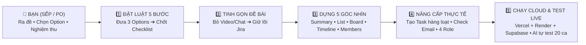

# CẨM NANG SLIDE THUYẾT TRÌNH (BẢN NGẮN GỌN — KEYWORD & SƠ ĐỒ TƯ DUY)
## Đề tài: Cách Điều Phối AI Từ Ý Tưởng Ra Sản Phẩm Web Hoàn Chỉnh (Case Study: TaskMG Workspace)

> **Mục tiêu bộ Slide:** Giúp bất kỳ ai nhìn vào trong **3 giây** là hiểu ngay **Sơ đồ tư duy & Các bước thực chiến** để chỉ đạo AI làm ra một sản phẩm chạy thật trên Internet (`https://taskmg-six.vercel.app/`).  
> **Nguyên tắc trình bày:** Ít chữ tối đa (3–7 từ/ý) • Dùng từ khóa hành động (Action Keywords) • Bố cục dạng Sơ đồ luồng (`👤 Sếp chỉ đạo` ➔ `🤖 AI thực thi` ➔ `🎯 Kết quả`).

---

## 🗺️ SƠ ĐỒ TƯ DUY TỔNG THỂ (MASTER MINDMAP)

---

## 📑 NỘI DUNG 8 SLIDES NGẮN GỌN THEO KEYWORD

### SLIDE 1: TRANG BÌA — CÁCH BIẾN Ý TƯỞNG THÀNH SẢN PHẨM THẬT CÙNG AI
- **Keyword hiển thị trên Slide:**
  - 👤 **Bạn = Sếp** *(Ra đề bài & Duyệt phương án)*
  - 🤖 **AI = Đội ngũ Kỹ thuật** *(Phân tích, Code, Test, Deploy)*
  - 🌐 **Sản phẩm thật:** `taskmg-six.vercel.app`
  - 💻 **Mã nguồn:** `github.com/HuyDdoox/taskmg`
- **Lời nói khi thuyết trình (15 giây):**
  > *"Slide này chia sẻ lại đúng quy trình thực tế tôi đã làm việc với AI như thế nào để từ một ý tưởng ban đầu tạo ra được hệ thống quản lý dự án chuẩn Jira chạy thật trên Cloud."*

---

### SLIDE 2: SƠ ĐỒ TƯ DUY — MÔ HÌNH "1 SẾP + 4 VAI TRÒ AI"
- **Sơ đồ 4 nhánh quanh Sếp:**
  1. 🧠 **AI làm BA:** Lên danh sách tính năng & luồng người dùng
  2. 💻 **AI làm Dev:** Lập trình Giao diện & Cơ sở dữ liệu
  3. 🧪 **AI làm QA:** Tự mở trình duyệt chạy kiểm thử
  4. ☁️ **AI làm DevOps:** Đưa web chạy Live 24/7 trên Cloud
- **Lời nói khi thuyết trình (20 giây):**
  > *"Thay vì coi AI chỉ là công cụ gõ code, tôi coi mình là Giám đốc sản phẩm (PO) và giao cho AI đóng đủ 4 vai trong một công ty phần mềm: từ phân tích nghiệp vụ, lập trình, kiểm thử cho đến đưa lên máy chủ."*

---

### SLIDE 3: BƯỚC 1 — ĐẶT "LUẬT 5 BƯỚC" ĐỂ AI KHÔNG CODE LOẠN
- **Sơ đồ luồng 5 bước ngang (`01 ➔ 02 ➔ 03 ➔ 04 ➔ 05`):**
  - **`01. Đưa 3 Options`** *(AI khảo sát & đề xuất hướng đi)*
  - **`02. Sếp Chọn Hướng`** *(Chọn Option tối ưu nhất)*
  - **`03. Chốt Checklist`** *(Cấm AI tự ý code khi chưa duyệt)*
  - **`04. Code & Tự Sửa`** *(AI tự chạy Build & sửa lỗi)*
  - **`05. Nghiệm Thu`** *(Báo cáo kết quả ngắn gọn)*
- **Lời nói khi thuyết trình (20 giây):**
  > *"Bí quyết đầu tiên là phải khóa cương AI bằng luật 5 bước: Trước mọi yêu cầu, AI bắt buộc phải đưa ra 3 phương án để tôi chọn, lập Checklist chờ tôi gật đầu duyệt rồi mới được viết code."*

---

### SLIDE 4: BƯỚC 2 — TINH GỌN ĐỀ BÀI (BỎ THỪA, GIỮ LÕI)
- **Sơ đồ So sánh 2 cột (`❌ Cắt Bỏ` vs `✅ Giữ Lõi`):**
  - ❌ **Cắt bỏ:** Video họp & Kênh Chat làm nặng web
  - ❌ **Cắt bỏ:** Gửi Mail OTP chậm chạp
  - ✅ **Giữ lõi:** Quản lý Đa dự án & Bảng Kanban chuẩn Jira
  - ✅ **Thay thế:** Link mời 1 lần (`/accept-invite`) & Chuông thông báo 🔔
- **Lời nói khi thuyết trình (20 giây):**
  > *"Khi AI vẽ ra quá nhiều tính năng như họp Video hay gửi mail OTP làm chậm hệ thống, tôi quyết định cắt bỏ ngay những phần rườm rà để tập trung 100% vào lõi quản lý dự án và tốc độ."*

---

### SLIDE 5: BƯỚC 3 — XÂY SẢN PHẨM THEO 5 GÓC NHÌN TRỰC QUAN
- **Sơ đồ 5 thẻ tính năng chính:**
  - 📊 **`1. Summary:`** Biểu đồ thống kê tiến độ
  - 📋 **`2. List:`** Bảng công việc *(Lọc, Sắp xếp 7 cột, Gom nhóm)*
  - 🗂️ **`3. Board:`** Bảng Kanban kéo thả 4 cột
  - 📅 **`4. Timeline:`** Chia giai đoạn *(Sprints)*
  - 👥 **`5. Members:`** Quản lý nhân sự dự án
- **Lời nói khi thuyết trình (15 giây):**
  > *"Từ đề bài đã tinh gọn, tôi chỉ đạo AI hoàn thiện không gian làm việc với 5 góc nhìn đồng bộ theo đúng chuẩn Jira: từ biểu đồ tổng quan, bảng danh sách, bảng kéo thả Kanban đến lộ trình Sprint."*

---

### SLIDE 6: BƯỚC 4 — SẾP DÙNG THỬ & CHỈ ĐẠO AI NÂNG CẤP THỰC TẾ
- **Sơ đồ 4 cặp `[Vấn đề thực tế] ➔ [Lệnh nâng cấp của Sếp]`:**
  1. 🎨 **Icon xấu** ➔ *Bắt đổi toàn bộ sang bộ Icon Font Awesome mới*
  2. ⚡ **Nhập từng task quá lâu** ➔ *Thêm tính năng **Tạo Task Hàng Loạt** (Dán danh sách / File CSV)*
  3. 🔍 **Sợ thêm nhầm người chưa đăng ký** ➔ *Thêm nút **Kiểm tra Email đã có tài khoản chưa***
  4. 🛡️ **Sợ nhân viên tự ý đóng việc** ➔ *Phân quyền **4 Role** (Khóa cột `Done` với Member)*
- **Lời nói khi thuyết trình (25 giây):**
  > *"Sau khi có khung sản phẩm, tôi trực tiếp vào dùng thử như người thật. Thấy icon xấu là bắt đổi; thấy nhập từng việc lâu là yêu cầu thêm Tạo Task Hàng Loạt; sợ thêm nhầm người là yêu cầu thêm bước Kiểm tra Email tài khoản trước khi thêm."*

---

### SLIDE 7: BƯỚC 5 — ĐƯA LÊN CLOUD & BẮT AI TỰ CHẠY TEST LIVE
- **Sơ đồ 4 khối kiểm chứng thực tế:**
  - ☁️ **3 Đám mây thật:** `Vercel` (Web) + `Render` (Realtime) + `Supabase` (Database)
  - 🤖 **Không nghe báo cáo suông:** Bắt AI mở trình duyệt chạy Test Live trước mặt
  - 🛒 **Test như thật:** AI tự đăng ký tài khoản mới, tạo dự án **OmniShop** & **10 Tasks**
  - ✅ **Kết quả:** Vượt qua **20/20 kịch bản** chức năng & bảo mật
- **Lời nói khi thuyết trình (20 giây):**
  > *"Đặc biệt, tôi không chấp nhận việc chỉ chạy trên máy cá nhân hay nghe AI báo cáo suông. Tôi yêu cầu đưa toàn bộ lên 3 đám mây thật, rồi bắt AI mở trình duyệt tự động tạo tài khoản mới, tạo dự án thương mại điện tử với 10 đầu việc thật ngay trước mắt để tôi theo dõi."*

---

### SLIDE 8: ĐÚC KẾT — 3 BÍ QUYẾT LÀM CHỦ AI ĐỂ TẠO SẢN PHẨM
- **3 Keyword vàng cho mọi dự án làm cùng AI:**
  - 🥇 **`01. Bắt AI đưa 3 Options trước khi code`** *(Bạn giữ quyền quyết định kiến trúc)*
  - 🥈 **`02. Liên tục dùng thử thật và bắt tinh chỉnh`** *(Biến bản nháp thành sản phẩm thực tế)*
  - 🥉 **`03. Bắt AI tự chạy trình duyệt test trên trang Live`** *(Kiểm chứng chất lượng 100%)*
- **Lời nói khi thuyết trình (15 giây):**
  > *"Tóm lại, bất kỳ ai cũng có thể làm ra sản phẩm hoàn chỉnh cùng AI nếu nắm giữ 3 nguyên tắc: Luôn bắt AI đưa phương án trước khi code, trực tiếp dùng thử để ra lệnh nâng cấp, và bắt AI tự kiểm thử trên môi trường thật. Xin cảm ơn!"*
