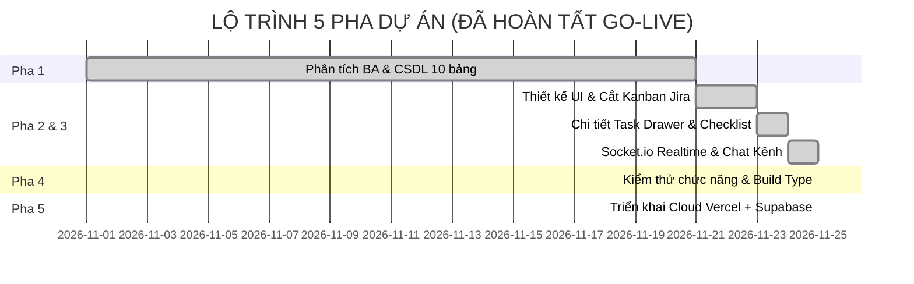

# BẢNG THEO DÕI TIẾN ĐỘ DỰ ÁN (PROJECT PROGRESS TRACKER)

> **Dự án:** Website Quản lý Công việc & Dự án (Task Management System)  
> **Cập nhật lần cuối:** 25/11/2026 15:05  
> **Tổng thể tiến độ:** **100% CÁC MODULE CỐT LÕI ĐÃ HOÀN THÀNH & GO-LIVE TRỰC TUYẾN**

---

## 📊 TIẾN ĐỘ 5 PHA DỰ ÁN

---

## 📌 BẢNG NGHIỆM THU CHI TIẾT TỪNG TASK

| Mã Task | Tên Công Việc | Ưu tiên | Rủi ro | Người làm | Trạng thái Nghiệm Thu |
| :---: | :--- | :---: | :---: | :---: | :---: |
| **TASK-1** | Thiết kế CSDL 10 bảng chuẩn hóa | `BLOCKER` | `CRITICAL` | Dev A | ✅ **HOÀN THÀNH (Đã đẩy Supabase)** |
| **TASK-2** | Khởi tạo dự án Next.js 15 & Prisma ORM | `HIGH` | `MEDIUM` | Dev A | ✅ **HOÀN THÀNH (Đã deploy Vercel)** |
| **TASK-3** | Xây dựng Bảng Kanban kéo thả chuẩn Jira | `HIGH` | `HIGH` | Dev A | ✅ **HOÀN THÀNH (Kéo thả 60fps)** |
| **TASK-4** | Tích hợp Drawer trượt xem Task & Checklist | `MEDIUM` | `LOW` | Dev A | ✅ **HOÀN THÀNH (Checklist % tiến độ)** |
| **TASK-5** | Cấu hình Socket.io đồng bộ realtime Kanban | `HIGH` | `HIGH` | Dev A | ✅ **HOÀN THÀNH (Render WebSocket)** |
| **TASK-6** | Xây dựng Kênh Chat dự án thời gian thực | `MEDIUM` | `MEDIUM` | Dev A | ✅ **HOÀN THÀNH (Lưu Supabase + Socket)** |
| **TASK-7** | Phân chia Giai đoạn dự án (Milestones) | `HIGH` | `MEDIUM` | Dev A | ✅ **HOÀN THÀNH (Tab Giai đoạn)** |

---

## 🌐 HẠ TẦNG CLOUD LIVE
- **Frontend & Fullstack Server Actions:** Vercel Hosting (Auto-deploy từ GitHub `main`).
- **Cơ sở dữ liệu:** Supabase PostgreSQL Cloud (Region: `ap-south-1`).
- **Máy chủ Realtime WebSocket:** Render Web Service (`server/`).
- **Kho lưu trữ mã nguồn:** GitHub [https://github.com/HuyDdoox/taskmg.git](https://github.com/HuyDdoox/taskmg.git).
