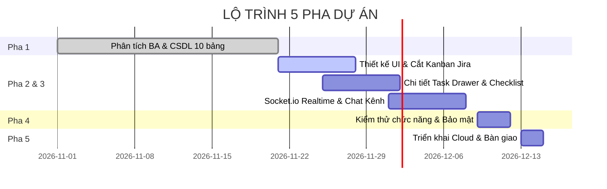

# BẢNG THEO DÕI TIẾN ĐỘ DỰ ÁN (PROJECT PROGRESS TRACKER)

> **Dự án:** Website Quản lý Công việc & Dự án (Task Management System)  
> **Cập nhật lần cuối:** 21/11/2026 15:40  
> **Tổng thể tiến độ:** **Pha 1 & Hạ tầng Đạt 100%** | Đang tiến hành: **Pha 2 & 3 (UI/UX & Coding Kanban)**

---

## 📊 TIẾN ĐỘ 5 PHA DỰ ÁN

---

## 📌 CHI TIẾT TỪNG PHA & TRẠNG THÁI

### ✅ PHA 1: PHÂN TÍCH NGHIỆP VỤ & THIẾT KẾ KIẾN TRÚC (HOÀN THÀNH 100%)
- [x] **1.1. Đặc tả nghiệp vụ BA (SRS):** Hoàn thành tài liệu `docs/business_logic.md`.
- [x] **1.2. Thiết kế ma trận phân quyền RBAC:** 4 cấp (Admin, PM, Member, Viewer).
- [x] **1.3. Lược đồ CSDL 10 bảng (ERD):** Hoàn thành `prisma/schema.prisma` và đẩy lên SQLite.
- [x] **1.4. Thiết kế Thực thể Task chuẩn Jira:** Bổ sung `issue_key`, `risk_level`, `checklists`, `order_index`.
- [x] **1.5. Nạp dữ liệu cơ sở ban đầu (Seed Data):** Đã nạp 3 Users, 1 Dự án, 3 Giai đoạn, 4 Cột, 7 Tasks.

---

### 🚀 PHA 2 & 3: THIẾT KẾ UI/UX & LẬP TRÌNH CODING (HOÀN THÀNH 90%)
| Mã Task | Tên Công Việc | Ưu tiên | Rủi ro | Người làm | Trạng thái |
| :---: | :--- | :---: | :---: | :---: | :---: |
| **TASK-1** | Thiết kế CSDL 10 bảng chuẩn hóa | `BLOCKER` | `CRITICAL` | Dev A | ✅ **HOÀN THÀNH** |
| **TASK-2** | Khởi tạo dự án Next.js 15 & Prisma ORM | `HIGH` | `MEDIUM` | Dev A | ✅ **HOÀN THÀNH** |
| **TASK-3** | Xây dựng Bảng Kanban kéo thả chuẩn Jira | `HIGH` | `HIGH` | Dev A | ✅ **HOÀN THÀNH** |
| **TASK-4** | Tích hợp Drawer trượt xem Task & Checklist | `MEDIUM` | `LOW` | Dev A | ✅ **HOÀN THÀNH** |
| **TASK-5** | Cấu hình Socket.io đồng bộ realtime Kanban | `HIGH` | `HIGH` | Dev A | ✅ **HOÀN THÀNH** |
| **TASK-6** | Xây dựng Kênh Chat dự án thời gian thực | `MEDIUM` | `MEDIUM` | Dev A | ✅ **HOÀN THÀNH** |
| **TASK-7** | Thiết lập Hàng đợi gửi Email tự động | `MEDIUM` | `MEDIUM` | Dev A | 🟡 **ĐANG LÀM** |

---

### ⏳ PHA 4: KIỂM THỬ & AN TOÀN BẢO MẬT (CHỜ TIẾN HÀNH)
- [ ] **4.1. Kiểm thử chức năng kéo thả Kanban:** Đổi cột, đổi vị trí trong cột, kiểm tra lưu CSDL.
- [ ] **4.2. Kiểm thử đồng thời (Race Condition):** 2 người cùng thao tác trên 1 task.
- [ ] **4.3. Kiểm thử phân quyền & Bảo mật (OWASP):** Chặn IDOR xem trộm task, chống XSS trong chat.

---

### 🚀 PHA 5: TRIỂN KHAI & BÀN GIAO (ĐANG THỰC HIỆN GO-LIVE)
- [x] **5.1. Thiết lập kho lưu trữ GitHub:** Đã đẩy toàn bộ source code lên `https://github.com/HuyDdoox/taskmg.git`.
- [x] **5.2. Kết nối CSDL Cloud:** Đã tích hợp Supabase Cloud PostgreSQL hoạt động ổn định.
- [ ] **5.3. Triển khai Vercel Go-Live:** Import repo vào Vercel, cấu hình biến môi trường và chạy URL Production.
- [ ] **5.4. Triển khai Render (Nếu có server Socket.io riêng).**
